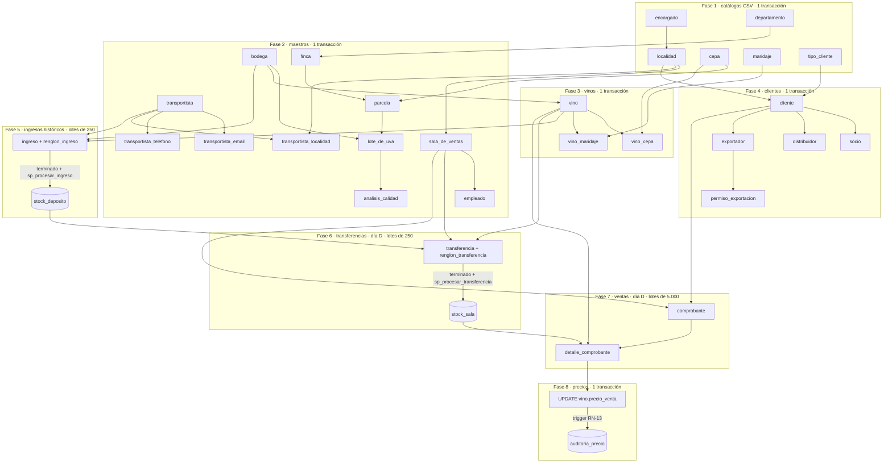

# Etapa 3 – Carga masiva de datos

Diseño de la carga implementada en `db/seed/`. Las instrucciones de
ejecución están en [`db/seed/README.md`](../db/seed/README.md) y el catálogo
de localidades en [`etapa3_localidades.md`](etapa3_localidades.md).

> Estado: el perfil `prueba` (volúmenes reducidos, misma lógica) se cargó en
> una PostgreSQL 16 aislada con las migraciones 001 a 007. Resultado: 0
> controles en FALLA, interrupción simulada revertida y reanudada sin
> duplicados. La carga **definitiva** todavía no se ejecutó. Las cantidades de
> §4 son las del perfil `definitivo`, generado con `--solo-plan`.

## 1. Decisiones principales

| Decisión | Motivo |
|---|---|
| **Python + psycopg 3 + `random` + Faker con semilla fija** (`carga_masiva.py`) | Es lo que pide el paso 3 de la Etapa 3. Cada sección del plan usa su propio generador, derivado de la semilla. |
| **Los triggers y las restricciones quedan activos**; no se usa `DISABLE TRIGGER` | El paso 5 del TPI deja elegir cómo cargar el historial. Elegimos no desactivar nada: la propia lógica de la base calcula precios, descuentos, totales y stock, y valida estados y porcentajes. |
| **Cronología anclada al día de la carga (opción A)** | `trg_transferencia_fecha` impone `fecha_confeccion = CURRENT_DATE`. Para que ninguna venta sea anterior a la transferencia que la abastece, los comprobantes también se fechan el día de la carga (ver §3.2). |
| **Primero se planifica en memoria y después se carga** | El plan completo (ventas, stock necesario, transferencias e ingresos) se calcula antes de escribir. El stock se dimensiona a partir de la demanda. |
| **COPY por lotes con transacciones por fase o por lote** | Paso 6 del TPI. `COPY` también dispara los triggers de fila. |
| **Relaciones por clave natural, nunca por posición** | Después de cada inserción se leen los `id` `SERIAL` usando la clave natural (dni, cuit, códigos, (nombre, cod_postal), etc.). |
| **Detección de estado sin tablas de control** | No se modifica el esquema. El estado de cada fase se deduce comparando la base con el plan. |

## 2. Orden de carga

Las flechas indican "se carga antes que" (dependencias de FK, de stock y de
cronología).

Orden completo de las 34 tablas: **1** encargado, departamento, cepa,
maridaje, tipo_cliente, localidad · **2** bodega, transportista,
transportista_email, transportista_telefono, sala_de_ventas,
transportista_localidad, empleado, finca, parcela, lote_de_uva,
analisis_calidad · **3** vino, vino_cepa, vino_maridaje · **4** cliente,
socio, distribuidor, exportador, permiso_exportacion · **5** ingreso,
renglon_ingreso, (stock_deposito por procedimiento) · **6** transferencia,
renglon_transferencia, (stock_sala por procedimiento) · **7** comprobante,
detalle_comprobante · **8** (auditoria_precio por trigger).

Los cambios de precio van **al final** a propósito: las ventas quedan con el
precio anterior y la auditoría registra el cambio posterior (RN-01, RN-13).

## 3. Cómo se cumple cada regla durante la carga

| Regla / mecanismo | Tratamiento en la carga |
|---|---|
| Encargados y localidades (RN-02) | De `encargados_auxiliares.csv` se insertan solo `dni`, `nombre` y `apellido`. Cada localidad busca su encargado por la clave (`nombre`, `cod_postal`) → `dni` → `id_encargado`. Después se verifica que la relación cargada coincida con el CSV. |
| Composición del vino (RN-05, trigger diferido) | En una misma transacción se insertan `vino`, `vino_cepa` (los cortes suman 100 en el plan) y `vino_maridaje`. Al final se ejecuta `SET CONSTRAINTS ALL IMMEDIATE`, que corre el control antes del COMMIT y, si algo falla, revierte toda la fase. |
| Maridajes | 1 a 3 por vino, elegidos según el tipo de vino. |
| Ingresos (RN-10, RN-12) | Se insertan en `en_confeccion` (DEFAULT) con sus renglones y su fecha histórica, pasan a `terminado` con un `UPDATE` y se procesan con `CALL sp_procesar_ingreso`. Cada ingreso trae solo vinos de **su** bodega. |
| Transferencias (RN-11, RN-12, RN-09) | Igual que los ingresos, con `CALL sp_procesar_transferencia`. **No se envía `fecha_confeccion`**: la fija el trigger. Se procesan después de todos los ingresos. |
| Estados → `procesado` | Solo lo hacen los procedimientos `SECURITY DEFINER`, cuyo dueño es el de las tablas. El script nunca cambia el estado a `procesado` con un `UPDATE` directo. |
| Ventas (RN-01, RN-06, RN-08, RN-09) | Se inserta el `comprobante` **sin fecha ni importes** (DEFAULT `CURRENT_DATE` y 0) y después sus renglones con precio, descuento y subtotal en 0, igual que en `tests/db_tests.sql`. `trg_detalle_validar` reemplaza esos valores y controla el stock con `FOR UPDATE`. `trg_detalle_actualizar` descuenta el stock y recalcula el comprobante a través de `trg_comprobante_totales`. |
| Auditoría (RN-13) | **No se inserta nada en `auditoria_precio`.** Las 40 filas las genera el trigger al actualizar `vino.precio_venta`. |
| Stock (RN-09) | **No se insertan filas en `stock_deposito` ni en `stock_sala`.** Las crean y actualizan solo los procedimientos y triggers. |
| Triggers activos | Antes de escribir se exige que existan los 12 triggers de 005, que su `tgenabled` sea `O` o `A` y que la sesión tenga `session_replication_role = 'origin'`. Con `replica`, los triggers `O` no se dispararían aunque figuren habilitados. El script no cambia ninguno de estos valores. |
| `search_path` | Las funciones de 003 y varias de 005 nombran las tablas sin esquema, así que la sesión fija `search_path = bodegas`. |

### 3.1 Por qué el stock nunca se queda corto

Los triggers `AFTER ROW` se ejecutan **al final de cada sentencia**. En un
`COPY` de muchos renglones, todos los controles `BEFORE` ven el stock que
había **antes** de la sentencia. Si el plan vendiera más de lo disponible, el
dominio `dom_cantidad` (>= 0) rechazaría la actualización del stock y se
revertiría el lote completo.

Para evitarlo, el plan se arma así:

1. Se generan las ventas y se suma la demanda por (sala, vino).
2. Cada (sala, vino) del catálogo recibe en transferencias
   `ceil(demanda × 1,10) + 6` botellas, repartidas en 3 transferencias.
3. Cada vino recibe en ingresos
   `max(apariciones, ceil(transferido × 1,05) + 24)` botellas.

Todo el stock entra antes de la primera venta, así que ningún lote puede
pedir más de lo que hay.

### 3.2 Cronología (opción A aprobada)

| Momento | Datos | Fecha |
|---|---|---|
| Historial (≤ `FIN_HISTORIAL` = 30/06/2026) | Campañas y cosechas 2022–2026 (del 1/2 al 30/4); análisis de 0 a 5 días después de la cosecha | Fija en el plan |
| | Añadas 2016–2023 | Fija en el plan |
| | Ingresos al depósito: 1/7/2024 – 31/12/2024 | Fija en el plan |
| | Altas de clientes 2012–2024; empleados 2008 – 30/6/2026; permisos 2021 – 30/6/2026 (después del alta) | Fija en el plan |
| Día de carga **D** | Transferencias | `CURRENT_DATE` (impuesta por `trg_transferencia_fecha`) |
| Día de carga **D**, después de las transferencias | Comprobantes y renglones | `CURRENT_DATE` (DEFAULT de `comprobante.fecha`) |

Garantías:

- **D proviene del servidor.** Es `CURRENT_DATE`, o la fecha de los
  comprobantes ya cargados si se reanuda. Tiene que ser posterior a
  `FIN_HISTORIAL`; si no, el script aborta.
- **El plan de ventas solo usa salas abiertas el día D.** Las salas que
  cierran ese día de la semana no venden, aunque igual reciben su stock
  mínimo. Por eso el plan depende del **día de la semana** de D.
- **Control antes de cada lote**, dentro de su transacción (la misma
  `CURRENT_DATE` que usa el DEFAULT):
  - no hay transferencias sin procesar ni con fecha futura;
  - ninguna sala del lote cierra hoy;
  - cada (sala, vino) del lote tiene una transferencia procesada con
    `fecha_confeccion <= CURRENT_DATE`.

  Si algo falla, se revierte ese lote y el script se detiene (código 2).
- **No hay ventas históricas.** Ninguna venta puede ser anterior a una
  transferencia.

**Costo aceptado:** las 150.000 ventas quedan en un solo día, o en dos si la
fase cruza la medianoche. La vista `mv_ventas_mensuales_sala` y las consultas
por rango de fechas de las Etapas 4 y 5 tendrán un único mes de ventas.

## 4. Registros previstos por tabla

| Tabla | Filas | | Tabla | Filas |
|---|---:|---|---|---:|
| encargado | 269 | | cliente | 20.000 |
| departamento | 18 | | socio | 17.000 |
| cepa | 12 | | distribuidor | 2.000 |
| maridaje | 8 | | exportador | 1.000 |
| tipo_cliente | 3 | | permiso_exportacion | 2.013 |
| localidad | 269 | | ingreso | 1.500 |
| bodega | 30 | | renglon_ingreso | 8.932 |
| transportista | 20 | | stock_deposito | 400 |
| transportista_email | 30 | | transferencia | 3.000 |
| transportista_telefono | 31 | | renglon_transferencia | **12.000** |
| transportista_localidad | 60 | | stock_sala | 4.000 |
| sala_de_ventas | 100 | | comprobante | **150.000** |
| empleado | 150 | | detalle_comprobante | **525.000** |
| finca | 120 | | auditoria_precio | 40 |
| parcela | 801 | | | |
| lote_de_uva | 3.759 | | | |
| analisis_calidad | 7.421 | | | |
| vino | 400 | | | |
| vino_cepa | 600 | | | |
| vino_maridaje | 786 | | | |

Las 34 tablas tienen filas. Cinco tablas superan las 10.000 filas
(cliente, socio, renglon_transferencia, comprobante y detalle_comprobante) y
dos superan las 100.000. Los 150.000 comprobantes y 525.000 renglones son
exactos por construcción: la mezcla de 1 a 6 renglones da una media de 3,5,
con vinos distintos dentro de cada comprobante. `stock_sala` sigue siendo
4.000, porque las salas que no venden el día D igual reciben transferencias.
`controlar_requisitos_volumen()` aborta si el plan no cumple los mínimos.

Son las cantidades exactas del plan con la semilla `20261106`, Faker 33.1.0
y Python 3.12.2 (`--solo-plan` del 06/11/2026). Las cantidades no dependen
del día de la semana de la carga: ese día solo cambia qué salas venden y las
cantidades transferidas. Otra semilla u otra versión de Faker o de Python
puede cambiar las tablas que no son exactas por construcción (parcelas,
lotes, análisis, composición, maridajes, permisos, renglones de ingreso,
emails y teléfonos).

## 5. Repetición controlada

Detalle de uso en el README. En resumen:

- Sin `--confirmar`, el script solo lee.
- **Estados de una fase.** Cada fase se clasifica comparando las claves
  naturales del plan, los conteos por tabla y, en las fases por lotes, el
  **contenido de una muestra** de hasta 300 documentos. La muestra compara
  cabecera y renglones, porque los códigos `SI-`, `STR-` y `SC-` son
  correlativos y por sí solos no prueban que el plan sea el mismo.
  - Los estados posibles son `pendiente`, `completa`, `en_curso` e
    `inconsistente`.
  - Una fase `inconsistente`, o una fase con datos cuando la anterior no está
    completa, detiene todo **sin modificar nada**.
- **Filas de más.** Si todas las fases están completas y hay filas de más
  (actividad posterior, por ejemplo de la API), la carga se informa como
  completa "con filas posteriores". Si la carga no terminó, las filas de más
  detienen el proceso.
- **Fases por lotes.** Las fases 5 a 7 son por lotes. Cada lote es atómico,
  así que un corte deja solo lotes completos y la reanudación sigue desde el
  primer documento que falta.
- **Bloqueo.** `pg_try_advisory_lock` impide dos cargas simultáneas.
- **Errores.** Los errores de PostgreSQL se informan con SQLSTATE, mensaje y
  contexto (código de salida 3).

## 6. Consultas de control (`db/seed/validaciones.sql`)

Es una única sentencia `SELECT` de solo lectura con **75 filas**: 34 conteos
por tabla y 41 controles. Cubre:

- **Volumen y huérfanas:** conteos por tabla y mínimos de volumen; filas
  huérfanas.
- **Stock:** stock negativo; conservación del stock; documentos sin procesar;
  ingresos con vinos de otra bodega.
- **Comprobantes:** total, subtotal y descuento contra sus renglones;
  comprobantes sin renglones; descuentos según el tipo de cliente; precios que
  no son ni el vigente ni uno anterior auditado.
- **Fechas de venta:** ventas antes del alta del cliente, en el día de cierre
  de la sala o antes del primer ingreso del vino.
- **Vinos, clientes y producción:** cortes que no suman 100; vinos sin
  maridaje; subtipos de cliente; permisos anteriores al alta; salas sin
  empleados; análisis anteriores a la cosecha; auditoría desalineada con el
  precio actual.

Controles de cronología, todos de **FALLA**:

| Control | Qué detecta |
|---|---|
| 900 | Comprobantes anteriores a la primera transferencia procesada. |
| 901 | Renglones vendidos antes de la primera transferencia procesada de su **(sala, vino)**, o sin ninguna. |
| 902 | Días en que lo vendido acumulado de un (sala, vino) supera lo transferido acumulado (saldo diario). |
| 903 | Días en que lo transferido acumulado de un vino supera lo ingresado al depósito (saldo diario). |
| 904 – 906 | Comprobantes, transferencias o ingresos con fecha futura. |
| 990 – 991 | INFO: cantidad de fechas distintas de transferencias y de comprobantes. |

Los controles marcados con `[*]` (402, 403, 404, 902 y 903) suponen una base
**recién cargada**. Con actividad posterior pueden dar FALLA sin que la carga
esté mal: por ejemplo, documentos en confección de la API o comprobantes
borrados con CASCADE, que no devuelven el stock. Los saldos diarios tienen
granularidad de día: dentro de un mismo día se toma primero lo que entra.

## 7. Riesgos y puntos a validar

1. **Prueba reducida, no definitiva.** El perfil `prueba` validó en una base
   aislada lo siguiente:
   - triggers, procedimientos, `COPY` y `CALL` por lotes;
   - el control diferido de cortes, el chequeo del dueño de la tabla y el
     `search_path`;
   - las 75 consultas de control;
   - la atomicidad de los lotes, la reanudación, el bloqueo consultivo y la
     detección de inconsistencias.

   Falta medir el volumen definitivo, en tiempo y espacio, sobre disco y no
   sobre `tmpfs`. Los perfiles se describen en el README ("Perfiles y prueba
   aislada").
2. **Ventas en un solo día** (costo de la opción A, §3.2). Afecta las
   consultas por mes y la vista materializada de las etapas siguientes.
3. **Reanudar los comprobantes otro día.** Solo es posible si ninguna sala con
   ventas pendientes cierra ese día de la semana. Si no, el script se detiene
   y hay que reanudar el mismo día de la semana. Por eso conviene iniciar la
   fase con tiempo antes de la medianoche.
4. **Tiempo de la fase de ventas.** Cada uno de los 525.000 renglones dispara
   dos triggers y un `UPDATE` del comprobante. Se recomienda
   `VACUUM (ANALYZE)` después (está en el README).
5. **Reproducibilidad.** Depende de la semilla, del día de la semana de la
   carga y de las versiones de Python y Faker (`Faker 33.1.0` trae `es_AR`,
   verificado en el repositorio de Faker). Los valores que asigna el motor
   (ids, fechas del día de carga, `fecha_hora` y `usuario` de la auditoría)
   no son reproducibles.
6. **Medición fila por fila.** `medir_insercion.py` no mide un COMMIT por
   fila: dejaría datos persistentes (ver README). La ventaja real de los lotes
   es mayor que la medida.
7. **Usuario.** La carga usa `POSTGRES_USER` (superusuario del contenedor). Con
   `bodegas_api` también funcionaría la lógica de negocio, pero `ANALYZE`
   omitiría las tablas que no le pertenecen.
8. **Coherencia de subtipos.** El control 602 depende de que los tipos de
   cliente se llamen `Socio`, `Distribuidor` y `Exportador`.
9. **Nombre de un departamento.** Se usa "Luján de Cuyo", la denominación
   del Anexo B.3, en los CSV de catálogo y en `carga_masiva.py` (`ZONAS` y
   `PESO_DEPTO_FINCA`).
10. **Pendiente del TPI.** Falta registrar en el informe los tiempos reales,
    la comparación de `medir_insercion.py` y el resultado de las consultas de
    control. También falta generar `dump_completo.sql.gz`.
