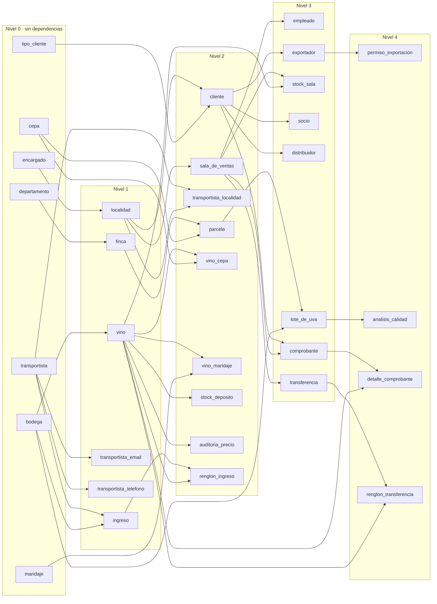

# Etapa 3 – Puntos 1 y 2: catálogos reales y orden de carga

Alcance de este documento: **solo** los pasos 1 y 2 de la Etapa 3 del TPI.

1. Cargar los catálogos reales desde archivos CSV, sin generarlos al azar.
2. Definir el orden de carga según las claves foráneas y dibujarlo para el
   informe.

La generación de datos sintéticos, la carga, el manejo de triggers, las
validaciones y el volcado (pasos 3 a 8) **no** forman parte de este documento.

Verificación realizada el 06/11/2026 leyendo los archivos: sin conexión a
ninguna base y sin generar datos.

---

## 1. Catálogos reales (CSV)

### 1.1 Archivos

Todos los archivos están en `db/seed/csv/`.

| Catálogo (consigna) | Archivo | Registros | Columnas | Tabla destino |
|---|---|---:|---|---|
| Cepas | `cepas.csv` | 12 | `nombre,tipo` | `cepa` |
| Maridajes | `maridajes.csv` | 8 | `nombre,temperatura_sugerida` | `maridaje` |
| Departamentos de Mendoza | `departamentos.csv` | 18 | `nombre,provincia` | `departamento` |
| Localidades de Mendoza | `localidades.csv` | 269 | `cod_postal,nombre,provincia,departamento` | `localidad` (`departamento` es una columna auxiliar) |
| Tipos de vino | — (no corresponde) | 4 valores | — | Catálogo implementado como `ENUM bodegas.tipo_vino`, usado por `vino.tipo` (ver 1.5) |

Hay además archivos de apoyo que no son catálogos de la consigna, pero que la
carga de localidades necesita o que la documentan:

| Archivo | Registros | Uso |
|---|---:|---|
| `encargados_auxiliares.csv` | 269 | Un encargado ficticio por localidad, porque `localidad.id_encargado` es `NOT NULL UNIQUE`. Las columnas `localidad` y `cod_postal` son auxiliares y no se insertan. |
| `localidades_excluidas.csv` | 36 | Localidades sin código postal. No se cargan; quedan como documentación. |
| `tipos_cliente.csv` | 3 | Socio 10 %, Distribuidor 20 % y Exportador 30 % (RN-06). |

### 1.2 Origen de los datos

| Catálogo | Fuente |
|---|---|
| Cepas | TPI, Anexo B.1: 7 tintas (Malbec, Cabernet Sauvignon, Merlot, Syrah, Bonarda, Tempranillo, Pinot Noir) y 5 blancas (Chardonnay, Sauvignon Blanc, Torrontés, Chenin Blanc, Semillón). |
| Maridajes | TPI, Anexo B.2: 8 maridajes con su temperatura de servicio. El anexo aclara que las temperaturas son orientativas. |
| Departamentos | Los 18 departamentos de Mendoza, con la denominación del TPI, Anexo B.3. En particular, se usa **Luján de Cuyo**, aunque la capa de IDE Mendoza abrevia el nombre como "Luján". |
| Localidades | IDE Mendoza, capa oficial `Localidades`, como fuente principal. Datos Abiertos Mendoza (2018) aporta 2 registros complementarios. El detalle, las normalizaciones y las exclusiones están en [`etapa3_localidades.md`](etapa3_localidades.md). |
| Tipos de vino | TPI, Anexo B.4: tinto, blanco, rosado y espumante. |

Ningún catálogo se genera al azar. Los únicos datos ficticios son los
encargados auxiliares, que no son un catálogo de la consigna.

### 1.3 Verificación

| Control | Resultado |
|---|---|
| Codificación | Los 7 archivos son UTF-8 estricto, sin BOM, con fin de línea LF, normalizados en NFC y sin caracteres dañados. |
| Encabezados y columnas | Encabezados correctos y la misma cantidad de columnas en todas las filas. |
| `cepas.csv` | Nombres únicos (`uq_cepa_nombre`), de hasta 50 caracteres; `tipo` dentro del `ENUM tipo_cepa` (`tinta`, `blanca`). |
| `maridajes.csv` | Nombres únicos (`uq_maridaje_nombre`), de hasta 60 caracteres. Temperaturas compatibles con `DECIMAL(4,1)`, entre 8,0 y 17,0. |
| `departamentos.csv` | 18 pares únicos de nombre y provincia (`uq_departamento_nombre_provincia`). Nombre de hasta 80 caracteres y provincia de hasta 50; provincia siempre `Mendoza`. |
| `localidades.csv` | `cod_postal` de 4 dígitos (`CHAR(4) NOT NULL`), nombre de hasta 80 caracteres, provincia `Mendoza`. Sin duplicados por nombre y departamento ni por nombre y código postal. |
| `tipos_cliente.csv` | Nombres únicos de hasta 20 caracteres; porcentajes 10, 20 y 30, dentro de `dom_porcentaje`. |
| `encargados_auxiliares.csv` | 269 DNI únicos de hasta 50 caracteres (`uq_encargado_dni`); relación 1 a 1 con las localidades. |

**Relación entre localidad y departamento.** El esquema no tiene una clave
foránea de `localidad` a `departamento`; solo `finca` referencia a
`departamento`. Por eso la relación se documenta en la columna auxiliar
`departamento` de `localidades.csv`, que no se inserta. Verificación:

- Todos los departamentos de `localidades.csv` existen en `departamentos.csv`.
- Los 18 departamentos tienen al menos una localidad. Por departamento:
  - Capital 1, General Alvear 19, Godoy Cruz 1, Guaymallén 21, Junín 9;
  - La Paz 7, Las Heras 20, Lavalle 23, Luján de Cuyo 19, Maipú 14;
  - Malargüe 22, Rivadavia 15, San Carlos 11, San Martín 17, San Rafael 41;
  - Santa Rosa 7, Tunuyán 12, Tupungato 10.

### 1.4 Observaciones de datos reales

Están documentadas en detalle en [`etapa3_localidades.md`](etapa3_localidades.md).

- *Media Luna* (General Alvear) conserva el código postal 6279, tal como lo
  informa la fuente, aunque sea una anomalía.
- *Barrancas (Mal)* y *Minacar* provienen de Datos Abiertos 2018.
- 36 localidades sin código postal quedaron excluidas, porque
  `cod_postal` es `NOT NULL`.

### 1.5 Tipos de vino: catálogo implementado con el ENUM `bodegas.tipo_vino`

**No existe un archivo `tipos_vino.csv`, y no hace falta.** El esquema
implementa este catálogo con un tipo enumerado
(`001_esquema.sql`, línea 6):

```sql
CREATE TYPE tipo_vino AS ENUM ('tinto', 'blanco', 'rosado', 'espumante');
```

La columna `vino.tipo` se declara `tipo_vino NOT NULL`.

| Valor del ENUM | Tipo de vino (Anexo B.4) |
|---|---|
| `tinto` | Tinto |
| `blanco` | Blanco |
| `rosado` | Rosado |
| `espumante` | Espumante |

Justificación:

- **El ENUM es el catálogo de valores permitidos.** Contiene exactamente los
  cuatro tipos del Anexo B.4, y PostgreSQL rechaza cualquier otro valor en
  `vino.tipo`. Cumple la misma función que una tabla de catálogo con su clave
  foránea, con una ventaja: los valores ya existen al aplicar
  `001_esquema.sql` y no dependen de ninguna carga.
- **Los datos no se generan al azar.** Los valores están fijados en el DDL
  versionado y salen del Anexo B.4.
- **Un CSV duplicaría información.** No habría ninguna tabla donde cargarlo, y
  cualquier diferencia entre el CSV y el ENUM sería una inconsistencia más
  para controlar.
- **No se modifica el esquema.** Convertir el ENUM en una tabla cambiaría el
  modelo de las Etapas 1 y 2, y no es necesario para cumplir la consigna.

Por lo tanto, el catálogo de tipos de vino que pide el paso 1 de la Etapa 3
está cubierto por el ENUM `bodegas.tipo_vino`.

---

## 2. Orden de carga por dependencias (claves foráneas)

Las dependencias salen de las 39 claves foráneas de `001_esquema.sql`.
`002_constraints.sql` las vuelve a crear con sus acciones referenciales, sin
cambiar las tablas a las que apuntan. Que las 39 coincidan se verificó
leyendo ambas migraciones.

El **nivel** de una tabla es 0 si no tiene claves foráneas, y si las tiene es
1 más el nivel máximo de las tablas a las que apunta. Se carga nivel por
nivel; dentro de un mismo nivel el orden no importa.

| Nivel | Tablas | Depende de |
|---|---|---|
| **0** (sin dependencias) | `bodega`, `cepa`, `departamento`, `encargado`, `maridaje`, `tipo_cliente`, `transportista` | — |
| **1** | `localidad` | encargado |
| | `finca` | departamento |
| | `vino` | bodega |
| | `transportista_email`, `transportista_telefono` | transportista |
| | `ingreso` | transportista, bodega |
| **2** | `sala_de_ventas` | localidad |
| | `cliente` | localidad, tipo_cliente |
| | `transportista_localidad` | transportista, localidad |
| | `parcela` | finca, cepa |
| | `vino_cepa` | vino, cepa |
| | `vino_maridaje` | vino, maridaje |
| | `stock_deposito`, `auditoria_precio` | vino |
| | `renglon_ingreso` | ingreso, vino |
| **3** | `empleado`, `transferencia` | sala_de_ventas |
| | `stock_sala` | sala_de_ventas, vino |
| | `socio`, `distribuidor`, `exportador` | cliente |
| | `comprobante` | cliente, sala_de_ventas |
| | `lote_de_uva` | parcela (`id_finca`, `num_parcela`), bodega (`id_bodega_entrega`) |
| **4** | `permiso_exportacion` | exportador |
| | `analisis_calidad` | lote_de_uva |
| | `detalle_comprobante` | comprobante, vino |
| | `renglon_transferencia` | transferencia, vino |

Las tablas con **dependencias múltiples** son: `ingreso`, `cliente`,
`transportista_localidad`, `parcela`, `vino_cepa`, `vino_maridaje`,
`renglon_ingreso`, `stock_sala`, `comprobante`, `lote_de_uva`,
`detalle_comprobante` y `renglon_transferencia`.

Los catálogos del punto 1 son todos de **nivel 0** (cepa, departamento,
maridaje, tipo_cliente) salvo `localidad`, que es de **nivel 1** porque
necesita que `encargado` esté cargado antes. Por eso los encargados
auxiliares se cargan primero.

Este orden refleja **solo** las claves foráneas. No indica cómo se llena cada
tabla ni qué datos le corresponden: eso es parte de los pasos siguientes.

### 2.1 Diagrama de dependencias

Cada flecha va de la tabla referenciada (que se carga antes) a la tabla que
la referencia.



El diagrama se ve directamente en GitHub y en VS Code con soporte para
Mermaid. Para un informe en Word o PDF se puede exportar a imagen, por
ejemplo con <https://mermaid.live> o con `mmdc`. La tabla de niveles de §2
sirve como versión en texto.

---

## 3. Decisiones tomadas y pendientes de los puntos 1 y 2

Decisiones tomadas:

1. **Tipos de vino.** El catálogo se cubre con el ENUM `bodegas.tipo_vino`
   (§1.5). No se crea un CSV ni se modifica el esquema.
2. **Departamento "Luján de Cuyo".** Se usa exclusivamente la denominación
   del Anexo B.3, en tres lugares:
   - `departamentos.csv`;
   - la columna auxiliar `departamento` de `localidades.csv` (19 localidades);
   - la columna `departamento` de `localidades_excluidas.csv` (3 localidades).

   El nombre de la **localidad** "Ciudad de Luján" no cambia, porque es el dato
   real de IDE Mendoza.

Pendiente:

3. **Incorporar el diagrama (§2.1) y la tabla de niveles al informe.** Si el
   informe no es Markdown, exportarlos como imagen.
